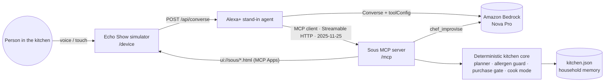

# Sous: the kitchen agent for Alexa+ that keeps everyone at the table safe and fed

**Sous** is a self-hosted **MCP server** (spec **2025-11-25**, **Streamable HTTP**, 44 tools, 253 tests) that gives Alexa+ a kitchen brain for the whole family:
- It plans dinner around the food that is about to expire.
- It keeps a child's food allergy and a grandparent's low-sodium diet out of every recipe, enforced in code.
- If someone describes a severe allergic reaction, it gives a fixed emergency script.
- It keeps the grocery budget, and orders exactly what is missing only after you say yes.
- It cooks with you hands-free, step by step, with timers.

On an Echo Show it renders rich, tappable cards through **MCP Apps**. It ships with an **Alexa+ / Echo Show simulator** whose agent is driven by **Amazon Bedrock** (Converse API with tool use) over a real MCP connection.

> Built for the *Build, Ship, Shape: Amazon Developer Hackathon*, Alexa+ track (+ AWS Builder mini challenge).
> All household and pantry data is synthetic. Orders go to a simulated Amazon Fresh store; nothing is purchased.

- **Live:** https://sous-alexa.vercel.app (landing) · **https://sous-alexa.vercel.app/device** (Echo Show simulator) · MCP endpoint `https://sous-alexa.vercel.app/mcp`
- Demo video: _add your YouTube link here_
- Local: `http://localhost:8787/device` (simulator) · `http://localhost:8787/` (landing)

## Why

Dinner is a safety decision, a money decision and a waste decision, made every day with your hands full.
- More than **33 million people in the US have a food allergy, about 1 in 13 children** ([FARE](https://www.foodallergy.org/resources/national-indicator-report-food-allergy)).
- **71.6% of adults 60 and older have high blood pressure** ([CDC NCHS Data Brief 511](https://www.cdc.gov/nchs/products/databriefs/db511.htm)).
- **13.5% of US households were food insecure at some point in 2023** ([USDA ERS](https://ers.usda.gov/sites/default/files/_laserfiche/publications/109896/ERR-337.pdf)).
- Meanwhile **30–40% of the US food supply is wasted** (USDA).

*"What's for dinner?"* is answered from habit, not from what is about to go off, who can't eat what, or what's left in the budget. The kitchen is also where Alexa lives: hands are wet and busy, and screens like Echo Show sit on the counter. Sous answers that question from the pantry's expiry dates and the family's needs, then carries the whole job through: plan → check it's safe for everyone → shop → cook → measure.

```
"Alexa, what should we cook tonight?"
→ "Tonight I'd make Spinach & Chickpea Coconut Curry. It uses your baby spinach and cooked rice before they expire
   tomorrow. I left out Peanut Sesame Noodles because Leo is allergic to peanuts."
"Plan dinners for the next three nights."
→ meal_suggest → meal_plan_set → shopping_cart_build  (three MCP tool calls, one sentence back)
→ "...You're missing fresh ginger, cilantro, cucumber and feta: $11.56 from Amazon Fresh. Should I place the order?"
"Yes, place the order."   → shopping_checkout (cartToken + explicit consent)
"Let's cook the first one." "Next." "Yes" (6-minute timer) ... "Next."
→ "Dinner's ready! You rescued baby spinach, tomatoes and cooked rice: $6.79 of food that would have gone in the bin."
```

## What makes it more than a wrapper

| Alexa+ "creative" signal (from the judging rules) | How Sous does it |
| --- | --- |
| Agentic workflow across services | "Plan the next three nights" chains planner → plan → grocery cart; Bedrock decides the chain itself |
| Context and state across sessions | Household memory (allergies, dislikes, notes), pantry, plan, cook progress and impact persist in `data/kitchen.json` |
| Purchasing | Draft cart with a `cartToken`; checkout needs explicit confirmation; idempotent replays; 30-minute cart expiry |
| Media support: cards and carousels | Five MCP Apps views: recipe carousel, cook-along, cart/receipt, pantry and impact chart |
| MCP Apps | Tools link `ui://sous/*.html` (`text/html;profile=mcp-app`) via `_meta.ui.resourceUri`; views call tools back on tap |
| Agent Skills | [`skills/sous-kitchen/SKILL.md`](skills/sous-kitchen/SKILL.md) teaches any agent the voice contract and workflows |
| Safety in code, not prompts | Allergy-emergency red flag with a fixed 911 / epinephrine script; allergen and diet guards on every recipe, substitute and scanned label; food safety that never says "safe" |

## Architecture



- **`src/mcp/server.ts`**: the MCP server: tools, resources, resource template, prompts, server instructions, MCP Apps views.
- **`src/domain/`**: the deterministic core. Ranking, allergens, carts and cooking are plain tested TypeScript, not prompts.
- **`src/agent/`**: the Alexa+ stand-in. It is a genuine MCP client of `/mcp` (it negotiates the protocol and the
  `io.modelcontextprotocol/ui` extension, lists tools, calls tools, reads `ui://` resources). Its brain is Amazon Bedrock;
  a deterministic router takes over when Bedrock is not configured or not reachable.
- **`ui/`**: MCP Apps views (self-contained HTML). **`web/`**: landing page and the Echo Show simulator host.

## MCP implementation

| | |
| --- | --- |
| SDK | `@modelcontextprotocol/sdk` 1.32 (TypeScript), low-level `Server` |
| Protocol | **2025-11-25** (negotiated) |
| Transport | **Streamable HTTP** on `POST/GET/DELETE /mcp` with `Mcp-Session-Id` sessions; optional DNS-rebinding protection (`ALLOWED_HOSTS`) |
| Capabilities | 44 tools, 8 resources + 1 template, 2 prompts, server `instructions` |
| Every tool has | `title`, `icons` (2025-11-25), behavior `annotations`, a JSON Schema `inputSchema` (from Zod), a shared `outputSchema`, and returns `structuredContent` plus a voice-ready text block |
| MCP Apps | `ui://sous/{meals,cook,cart,pantry,impact}.html`, mime `text/html;profile=mcp-app`, `_meta.ui.csp` for fonts |

### Tools (44)

| Group | Tools |
| --- | --- |
| **Core kitchen** | `pantry_check`, `pantry_update`, `meal_suggest` (use-it-up ranking, allergen/diet/dislike exclusions with reasons), `chef_improvise` (**Amazon Bedrock**, allergen re-check, template fallback), `meal_plan_set`, `shopping_cart_build`, `shopping_checkout` (token + explicit yes, idempotent), `cook_start`, `cook_step`, `timer_set`, `household_memory`, `impact_report` |
| **Safety for everyone at the table** | `allergy_emergency` (deterministic red flag: fixed "call 911 / use the prescribed epinephrine auto-injector" script, negation-aware), `allergen_scan` (product labels incl. "may contain"), `diet_profile` (per-member low-sodium, diabetes-friendly, vegetarian, soft-foods, dairy-free, gluten-free; filters `meal_suggest`), `meal_safety_check` (per-person verdict), `cross_contact_tips`, `cooking_temp` (USDA safe internal temps), `food_safety_check` (conservative, never says "safe"), `substitute_ingredient` (allergy-aware) |
| **Budget & community** | `budget_set`, `budget_status`, `budget_meal_plan`, `price_check`, `donate_surplus` (community fridge, simulated), `leftovers_log` (3–4 day window), `leftovers_ideas`, `waste_log`, `waste_insights` |
| **Planning** | `recipe_search`, `recipe_details` (scaled, allergen check), `meal_plan_get`, `meal_plan_clear`, `unit_convert`, `timer_list`, `timer_cancel`, `cook_status` |
| **Household** | `household_members`, `pantry_add_receipt`, `daily_brief`, `order_history`, `reorder_staples` (same purchase gate), `delivery_slots`, `shopping_list` (feeds the cart) |

Every tool has a `title`, `icons`, behavior `annotations` (`readOnlyHint` / `destructiveHint` / `idempotentHint` / `openWorldHint`), a JSON Schema `inputSchema`, the shared `outputSchema`, and returns `structuredContent` plus a voice-ready text block. Tool modules live in `src/mcp/tools/` and register through `src/mcp/registry.ts`.

Resources: `sous://household`, `sous://pantry`, `sous://impact`, `sous://recipe/{id}` and the five `ui://` views.
Prompts: `plan_tonight`, `use_it_up_week`.

### The voice contract

Each result's `structuredContent` is `{ ok, tool, speech, view?, data, followUp? }`. `speech` is one to three short sentences.
`followUp` carries **the exact next call** (for example `shopping_checkout` with the `cartToken`), so a "yes" on the next
turn never depends on a model rebuilding arguments from speech. Refusals return `isError` with a spoken recovery line,
never a dead end.

## Safety lives in code, not in prompts

- **Allergy-emergency red flag.** `allergy_emergency` matches severe-reaction signs (swelling of lips, tongue or throat; trouble
  breathing; wheezing; hives after eating), with negation handling. It returns a constant script: call 911, and use the prescribed
  epinephrine auto-injector as directed. No model writes or edits it.
- **Diet needs as hard filters.** `diet_profile` plugs into the planner's recipe-filter hook (`src/domain/hooks.ts`).
- **Food safety without false reassurance.** `food_safety_check` gives dates and conservative windows and never says "safe".
  `cooking_temp` gives USDA safe minimum internal temperatures.
- **Allergen guard.** Allergies are hard filters applied to every ranked recipe (`allergenHits`) and to every model-written
  recipe (`allergenHitsInText`, which also catches words like "satay"). A Bedrock idea that mentions an allergen is discarded
  and Sous says so.
- **Purchase gate, three layers.** (1) The tool needs a server-issued `cartToken` and `confirmed: true`. (2) The host agent
  downgrades `confirmed` to `false` unless the person said yes, or tapped *Place order*, in that very turn, so a model cannot
  buy on its own. (3) Replays are idempotent and carts expire after 30 minutes.
- **Never a dead end.** Bedrock calls have a time budget and a circuit breaker; on any auth or model error Sous keeps working
  on the deterministic engine (`/healthz` shows the status).

## AWS integration (AWS Builder)

- **Amazon Bedrock Converse API with tool use** (`@aws-sdk/client-bedrock-runtime`, `src/aws/bedrock.ts`, `src/agent/agent.ts`):
  the Alexa+ stand-in maps the MCP `tools/list` result to Bedrock `toolConfig`, runs up to four tool rounds per turn, and
  sends every tool call through MCP. Default model: `us.amazon.nova-pro-v1:0` (configurable).
- **Bedrock inside the tool path**: `chef_improvise` asks Bedrock for a strict-JSON recipe built around expiring
  ingredients, then validates it deterministically.
- Credentials: a Bedrock API key (`AWS_BEARER_TOKEN_BEDROCK`) or any standard AWS credential chain. See `.env.example`.

## Run it

Requires Node.js 20+.

```bash
git clone https://github.com/johnbosco-j/sous && cd sous
npm install
npm start            # MCP at http://localhost:8787/mcp, simulator at /device, landing at /
```

Then open **http://localhost:8787/device** in Chrome (it supports the Web Speech API for the mic; any browser can type or tap the suggestion chips).
Press **t** to open the MCP trace drawer. Use **Reset demo** to reseed.

Optional, for Amazon Bedrock:

```bash
cp .env.example .env   # set AWS_BEARER_TOKEN_BEDROCK (or IAM keys) and AWS_REGION
npm start              # the console prints which brain is active
```

### Use it from any MCP client

The hosted server runs **stateless Streamable HTTP** on Vercel (a fresh MCP server per POST, which suits serverless), with demo state kept per instance in `/tmp`. There, the simulator's agent talks MCP to Sous over the SDK's in-memory transport. Locally it uses Streamable HTTP sessions (`Mcp-Session-Id`).


- **MCP Inspector:** `npx @modelcontextprotocol/inspector`, then choose transport *Streamable HTTP* and enter URL `https://sous-alexa.vercel.app/mcp` (or `http://localhost:8787/mcp`).
- **Alexa+ (developer preview):** expose the server over HTTPS (for example `cloudflared tunnel --url http://localhost:8787`)
  and register `https://<tunnel>/mcp` as the add-on's MCP endpoint. The bundled simulator behaves like the web simulator's
  isolation mode: every utterance is routed to this add-on.
- **Agent Skill:** copy `skills/sous-kitchen` into your agent's skills folder.

### Tests

```bash
npm test        # 253 tests: planner, allergen guard, purchase gate, cooking, voice router, MCP protocol over
                # Streamable HTTP, and the Bedrock tool loop (scripted Converse mock), including a model that tries to buy without consent, and offline small talk
npm run typecheck
```

## Project layout

```
src/index.ts            Express app: /mcp (Streamable HTTP), /api/* for the simulator, static web/
src/mcp/server.ts       MCP server: core tools, resources, prompts, MCP Apps wiring
src/mcp/registry.ts     tool registry shared by the tool modules
src/mcp/tools/          tool modules: safety, budget, planning, household
src/domain/             catalog (ingredients, recipes, demo household), store (persistence), kitchen (core logic)
src/agent/              Alexa+ stand-in: MCP client + Bedrock tool loop + deterministic router
src/aws/bedrock.ts      Bedrock Converse client, circuit breaker, recipe improviser
ui/                     MCP Apps views served as ui://sous/*.html
web/                    landing page (/) and Echo Show simulator (/device)
skills/sous-kitchen/    Agent Skill
test/                   Vitest suites
docs/                   submission, demo script, friction log, research
```

## Production path (not done in this hackathon build)

- OAuth 2.1 (authorization code + PKCE) account linking and protected-resource metadata, as Alexa+ add-ons require.
- A real grocery integration in place of the simulated store; a database instead of a JSON file; multiple households.
- Recipe catalog import and nutrition data.

## Built during the hackathon

Everything in this repository was written on 23 October 2026, during the submission window.

## License

MIT. See [LICENSE](LICENSE). Three.js (MIT) is vendored for the landing page. Alexa, Echo Show, Amazon Fresh and Amazon Bedrock
are trademarks of Amazon.com, Inc. or its affiliates; this is an independent hackathon project.
